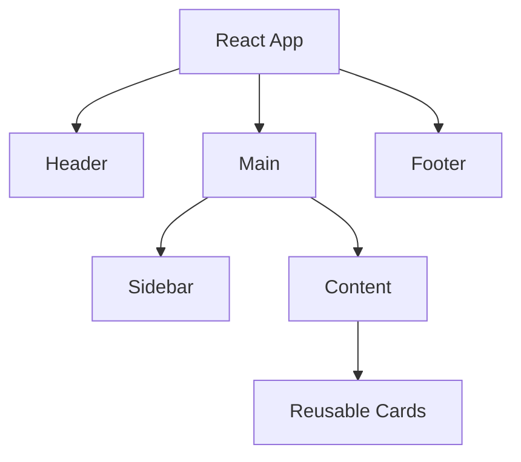
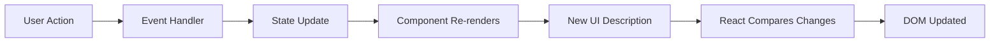
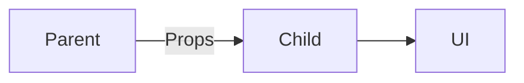
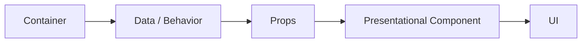
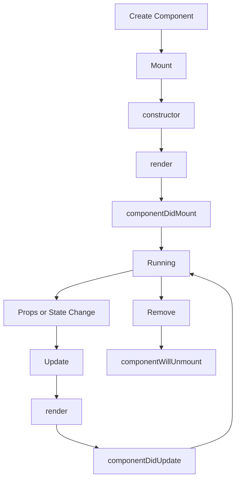
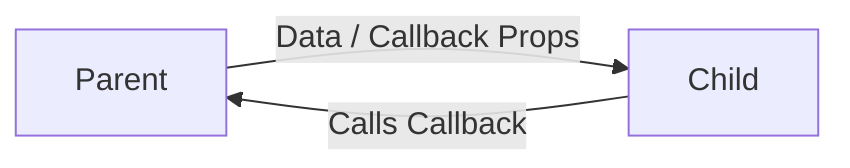

# React JS Module 5 — Components

> Beginner → Intermediate → Professional  
> **Topics:** React Components, Functional Components, Class Components, Pure Components, Container/Presentational Pattern, PropTypes, Lifecycle  
> **Recommended setup:** React + Vite + JavaScript

## 1. Learning Objectives

By the end of this module you should be able to:

- Create reusable React components.
- Pass and destructure props.
- Manage state with `useState`.
- Compose and nest components.
- Understand and read class components.
- Understand `PureComponent` and `React.memo()`.
- Understand container/presentational architecture.
- Validate JavaScript props with `prop-types`.
- Understand mounting, updating and unmounting.
- Choose functional components for modern React development.

---

# 2. What Is a React Component?

A React component is a reusable UI building block. A component can receive data through props, manage state, respond to events, and return JSX.

```text
React Application
│
├── Navbar
├── Sidebar
├── Dashboard
│   ├── StatsCard
│   ├── Chart
│   └── RecentOrders
└── Footer
```



## Basic Syntax

```jsx
function Greeting() {
  return <h1>Hello, React!</h1>;
}

export default Greeting;
```

Use it with:

```jsx
import Greeting from "./Greeting";

function App() {
  return <Greeting />;
}
```

---

# 3. How Components Work

A simplified flow:



The important idea is that you describe the UI from current props/state. When relevant data changes, React renders again and commits the necessary DOM changes.

---

# 4. Functional Components

Functional components are JavaScript functions that return JSX. They are the standard approach for new React development and can use Hooks.

## Example 1 — Simple Component

```jsx
function Welcome() {
  return <h1>Welcome to React</h1>;
}
```

**Explanation:** A simple component with no props or state.

## Example 2 — Reusable Button

```jsx
function Button() {
  return <button>Click Me</button>;
}
```

**Explanation:** Create once and reuse with `<Button />`.

## Example 3 — Props

```jsx
function Greeting({ name }) {
  return <h2>Hello, {name}!</h2>;
}

// Usage
<Greeting name="Amit" />;
```

**Explanation:** The parent supplies `name`; the child uses it to create dynamic UI.

## Example 4 — Multiple Props

```jsx
function StudentCard({ name, course, age }) {
  return (
    <div>
      <h2>{name}</h2>
      <p>{course}</p>
      <p>{age}</p>
    </div>
  );
}
```

**Explanation:** A component can accept several props.

## Example 5 — State

```jsx
import { useState } from "react";

function Counter() {
  const [count, setCount] = useState(0);

  return (
    <>
      <p>Count: {count}</p>
      <button onClick={() => setCount(count + 1)}>
        Increment
      </button>
    </>
  );
}
```

**Explanation:** `count` stores the current value and `setCount` updates it.

## Example 6 — Toggle

```jsx
import { useState } from "react";

function Toggle() {
  const [open, setOpen] = useState(false);

  return (
    <>
      <button onClick={() => setOpen(!open)}>
        {open ? "Close" : "Open"}
      </button>
      {open && <p>Panel is open.</p>}
    </>
  );
}
```

**Explanation:** State controls whether the panel is displayed.

## Example 7 — Conditional UI

```jsx
function UserStatus({ loggedIn }) {
  return loggedIn
    ? <h2>Welcome back!</h2>
    : <h2>Please log in.</h2>;
}
```

**Explanation:** Props can determine which UI is rendered.

## Example 8 — List Component

```jsx
function Skills() {
  const skills = ["React", "Node.js", "AWS"];

  return (
    <ul>
      {skills.map((skill) => (
        <li key={skill}>{skill}</li>
      ))}
    </ul>
  );
}
```

**Explanation:** `map()` converts data into repeated UI.

## Example 9 — Event Handler

```jsx
function LoginButton() {
  function handleLogin() {
    alert("Login clicked");
  }

  return <button onClick={handleLogin}>Login</button>;
}
```

**Explanation:** React event props receive a function reference.

## Example 10 — Reusable Card

```jsx
function Card({ title, description }) {
  return (
    <article className="card">
      <h2>{title}</h2>
      <p>{description}</p>
    </article>
  );
}
```

**Explanation:** The same card component can be reused for jobs, courses, products, posts, etc.

---

# 5. Props

Props are read-only inputs passed from a parent to a child.



```jsx
function User({ name }) {
  return <h2>{name}</h2>;
}

function App() {
  return <User name="Sahil" />;
}
```

## Props Destructuring

Instead of:

```jsx
function User(props) {
  return <h2>{props.name}</h2>;
}
```

write:

```jsx
function User({ name }) {
  return <h2>{name}</h2>;
}
```

## `props.children`

```jsx
function Card({ children }) {
  return <div className="card">{children}</div>;
}

<Card>
  <h2>React Course</h2>
  <p>Beginner to Advanced</p>
</Card>;
```

`children` makes wrapper components flexible.

---

# 6. Component Composition

```jsx
function Header() {
  return <header>My Website</header>;
}

function Footer() {
  return <footer>Copyright 2026</footer>;
}

function App() {
  return (
    <>
      <Header />
      <main>Main content</main>
      <Footer />
    </>
  );
}
```

Tree:

```text
App
├── Header
├── Main
└── Footer
```

Composition is one of the main ways to build large applications from small pieces.

---

# 7. Class Components

Class components are ES6 classes extending `React.Component`. They are still supported and are important when maintaining legacy applications.

## Example 1 — Basic Class

```jsx
import React from "react";

class Welcome extends React.Component {
  render() {
    return <h1>Welcome to React</h1>;
  }
}
```

**Explanation:** `render()` returns the component UI.

## Example 2 — Props

```jsx
class Greeting extends React.Component {
  render() {
    return <h2>Hello, {this.props.name}!</h2>;
  }
}

// <Greeting name="Amit" />
```

**Explanation:** Class components access props through `this.props`.

## Example 3 — State

```jsx
class Counter extends React.Component {
  constructor(props) {
    super(props);
    this.state = { count: 0 };
  }

  render() {
    return <h2>{this.state.count}</h2>;
  }
}
```

**Explanation:** Class state is stored in `this.state`.

## Example 4 — `setState`

```jsx
class Counter extends React.Component {
  state = { count: 0 };

  increment = () => {
    this.setState((prev) => ({
      count: prev.count + 1
    }));
  };

  render() {
    return (
      <>
        <p>{this.state.count}</p>
        <button onClick={this.increment}>+</button>
      </>
    );
  }
}
```

**Explanation:** Use `setState`, not direct mutation of `this.state`.

## Example 5 — Multiple State Values

```jsx
class User extends React.Component {
  state = {
    name: "Amit",
    age: 22,
    active: true
  };

  render() {
    return <p>{this.state.name}</p>;
  }
}
```

**Explanation:** State can contain multiple related values.

## Example 6 — Event Handler

```jsx
class Login extends React.Component {
  handleLogin = () => {
    alert("Login successful");
  };

  render() {
    return <button onClick={this.handleLogin}>Login</button>;
  }
}
```

**Explanation:** The class field arrow function preserves the component instance context.

## Example 7 — Constructor

```jsx
class Profile extends React.Component {
  constructor(props) {
    super(props);
    this.state = { username: "admin" };
  }

  render() {
    return <h2>{this.state.username}</h2>;
  }
}
```

**Explanation:** `super(props)` initializes the parent class before using `this`.

## Example 8 — `componentDidMount`

```jsx
class Users extends React.Component {
  componentDidMount() {
    console.log("Mounted");
  }

  render() {
    return <h2>Users</h2>;
  }
}
```

**Explanation:** Runs after the component is mounted; historically common for side effects.

## Example 9 — `componentDidUpdate`

```jsx
class Counter extends React.Component {
  componentDidUpdate(prevProps, prevState) {
    console.log(prevState.count, this.state.count);
  }

  render() {
    return <h2>{this.state.count}</h2>;
  }
}
```

**Explanation:** Runs after an update.

## Example 10 — `componentWillUnmount`

```jsx
class Timer extends React.Component {
  componentDidMount() {
    this.timer = setInterval(() => console.log("tick"), 1000);
  }

  componentWillUnmount() {
    clearInterval(this.timer);
  }

  render() {
    return <h2>Timer</h2>;
  }
}
```

**Explanation:** Cleanup runs before the component is removed.

---

# 8. Functional vs Class Components

| Feature | Functional | Class |
|---|---|---|
| Structure | Function | ES6 class |
| State | `useState`, `useReducer` | `this.state`, `this.setState()` |
| Side effects | Hooks such as `useEffect` | Lifecycle methods |
| Rendering | JSX returned directly | `render()` returns JSX |
| Hooks | Yes | No |
| `this` | Not required | Used for props/state/methods |
| Boilerplate | Lower | Higher |
| New development | Preferred | Usually legacy/maintenance |
| Existing old projects | Yes | Common |

The referenced GeeksforGeeks comparison similarly describes functional components as simpler and Hook-based, class components as ES6 classes with state/lifecycle methods, and recommends functional components for most new development while noting class components remain relevant in legacy codebases. citeturn0view0

Reference: https://www.geeksforgeeks.org/blogs/differences-between-functional-components-and-class-components/

---

# 9. Pure Components

`React.PureComponent` is a class-based optimization that performs shallow comparison of props and state.

```jsx
import React from "react";

class UserCard extends React.PureComponent {
  render() {
    return <h2>{this.props.name}</h2>;
  }
}
```

## Example 1 — Basic

```jsx
class Profile extends React.PureComponent {
  render() {
    return <h2>{this.props.name}</h2>;
  }
}
```

**Explanation:** React can skip an update when the relevant props/state are shallowly equal.

## Example 2 — Counter Display

```jsx
class Counter extends React.PureComponent {
  render() {
    return <h2>{this.props.count}</h2>;
  }
}
```

**Explanation:** Primitive prop changes are easy to compare.

## Example 3 — Boolean

```jsx
class Status extends React.PureComponent {
  render() {
    return <p>{this.props.online ? "Online" : "Offline"}</p>;
  }
}
```

**Explanation:** Boolean props are compared by value.

## Example 4 — Product Card

```jsx
class ProductCard extends React.PureComponent {
  render() {
    return (
      <article>
        <h2>{this.props.name}</h2>
        <p>₹{this.props.price}</p>
      </article>
    );
  }
}
```

**Explanation:** Useful when a large product UI receives stable props.

## Example 5 — Student Row

```jsx
class StudentRow extends React.PureComponent {
  render() {
    return (
      <tr>
        <td>{this.props.name}</td>
        <td>{this.props.marks}</td>
      </tr>
    );
  }
}
```

**Explanation:** Can help avoid unnecessary work in large tables when references are stable.

## Example 6 — Array Prop

```jsx
class Skills extends React.PureComponent {
  render() {
    return this.props.skills.map((skill) => (
      <span key={skill}>{skill}</span>
    ));
  }
}
```

**Explanation:** Arrays are compared by reference, not deep contents.

## Example 7 — Immutable Update

```jsx
setUsers((prev) => [
  ...prev,
  newUser
]);
```

**Explanation:** A new array reference makes changes visible to shallow comparison.

## Example 8 — Avoid Mutation

Avoid:

```jsx
user.name = "New";
```

Prefer:

```jsx
setUser((prev) => ({
  ...prev,
  name: "New"
}));
```

**Explanation:** Immutable updates make reference-based change detection reliable.

## Example 9 — Multiple Props

```jsx
class Employee extends React.PureComponent {
  render() {
    return (
      <div>
        <h2>{this.props.name}</h2>
        <p>{this.props.role}</p>
      </div>
    );
  }
}
```

**Explanation:** Multiple props are shallowly compared.

## Example 10 — Functional Equivalent

```jsx
import { memo } from "react";

const UserCard = memo(function UserCard({ name }) {
  return <h2>{name}</h2>;
});
```

**Explanation:** `memo()` is the common functional-component memoization counterpart. It should be used when it solves a real rendering/performance need, not automatically everywhere.

---

# 10. Container and Presentational Pattern

The pattern separates:

```text
Container
→ data + behavior

Presentational
→ appearance + rendering
```



## Example 1 — Users

```jsx
function UserList({ users }) {
  return (
    <ul>
      {users.map((user) => (
        <li key={user.id}>{user.name}</li>
      ))}
    </ul>
  );
}

function UserContainer() {
  const users = [
    { id: 1, name: "Amit" },
    { id: 2, name: "Riya" }
  ];

  return <UserList users={users} />;
}
```

**Explanation:** `UserContainer` owns/prepares data; `UserList` focuses on UI.

## Example 2 — Products

```jsx
function ProductList({ products }) {
  return products.map((p) => (
    <p key={p.id}>{p.name} - ₹{p.price}</p>
  ));
}

function ProductContainer() {
  const products = [
    { id: 1, name: "Laptop", price: 55000 },
    { id: 2, name: "Mouse", price: 1000 }
  ];

  return <ProductList products={products} />;
}
```

**Explanation:** Product data and display are separated.

## Example 3 — Profile

```jsx
function ProfileView({ user }) {
  return <h2>{user.name}</h2>;
}

function ProfileContainer() {
  const user = {
    name: "Sahil",
    email: "sahil@example.com"
  };

  return <ProfileView user={user} />;
}
```

**Explanation:** The view does not need to know where the data came from.

## Example 4 — Dashboard

```jsx
function DashboardView({ stats }) {
  return (
    <>
      <p>Users: {stats.users}</p>
      <p>Orders: {stats.orders}</p>
    </>
  );
}

function DashboardContainer() {
  const stats = { users: 1200, orders: 450 };
  return <DashboardView stats={stats} />;
}
```

**Explanation:** Useful for separating dashboard data preparation from presentation.

## Example 5 — Search

```jsx
function SearchResults({ results }) {
  return results.map((r) => (
    <li key={r.id}>{r.title}</li>
  ));
}

function SearchContainer() {
  const results = [
    { id: 1, title: "React" },
    { id: 2, title: "JavaScript" }
  ];

  return <SearchResults results={results} />;
}
```

**Explanation:** Search result rendering stays reusable.

## Example 6 — Orders

```jsx
function OrderTable({ orders }) {
  return orders.map((o) => (
    <p key={o.id}>{o.id}: {o.status}</p>
  ));
}

function OrderContainer() {
  const orders = [
    { id: 101, status: "Delivered" },
    { id: 102, status: "Pending" }
  ];

  return <OrderTable orders={orders} />;
}
```

**Explanation:** Data preparation is separated from table/list presentation.

## Example 7 — Notification

```jsx
function NotificationView({ message }) {
  return <div>{message}</div>;
}

function NotificationContainer() {
  return (
    <NotificationView message="New notification received." />
  );
}
```

**Explanation:** The view only knows how to display the message.

## Example 8 — Course

```jsx
function CourseCard({ course }) {
  return (
    <article>
      <h2>{course.title}</h2>
      <p>{course.duration}</p>
    </article>
  );
}

function CourseContainer() {
  const course = {
    title: "React JS",
    duration: "8 Weeks"
  };

  return <CourseCard course={course} />;
}
```

**Explanation:** Course information is supplied by the container.

## Example 9 — Cart

```jsx
function CartView({ items }) {
  return items.map((item) => (
    <li key={item.id}>
      {item.name} × {item.quantity}
    </li>
  ));
}

function CartContainer() {
  const items = [
    { id: 1, name: "Keyboard", quantity: 2 },
    { id: 2, name: "Mouse", quantity: 1 }
  ];

  return <CartView items={items} />;
}
```

**Explanation:** The cart view can remain focused on rendering.

## Example 10 — API-style separation

```jsx
function UsersView({ users, loading }) {
  if (loading) return <p>Loading...</p>;

  return users.map((u) => (
    <p key={u.id}>{u.name}</p>
  ));
}

function UsersContainer() {
  const loading = false;
  const users = [
    { id: 1, name: "Amit" },
    { id: 2, name: "Priya" }
  ];

  return (
    <UsersView
      users={users}
      loading={loading}
    />
  );
}
```

**Explanation:** In a real project, the container/data layer could obtain data from an API or Hook.

### Modern note

This pattern is useful, but it is not a mandatory React rule. Hooks and composition often allow data and UI logic to be organized without rigidly labeling every component as a container or presentational component.

---

# 11. PropTypes

`prop-types` is a separate package for runtime development-time validation of props in JavaScript React applications.

Install:

```bash
npm install prop-types
```

Basic example:

```jsx
import PropTypes from "prop-types";

function Greeting({ name }) {
  return <h2>Hello, {name}</h2>;
}

Greeting.propTypes = {
  name: PropTypes.string.isRequired
};
```

## Example 1 — String

```jsx
User.propTypes = {
  name: PropTypes.string.isRequired
};
```

**Explanation:** `name` must be a required string.

## Example 2 — Number

```jsx
Age.propTypes = {
  age: PropTypes.number.isRequired
};
```

**Explanation:** Validates a number prop.

## Example 3 — Boolean

```jsx
Status.propTypes = {
  active: PropTypes.bool.isRequired
};
```

**Explanation:** Validates true/false data.

## Example 4 — Function

```jsx
Button.propTypes = {
  onClick: PropTypes.func.isRequired
};
```

**Explanation:** Useful for callback props.

## Example 5 — Array

```jsx
Skills.propTypes = {
  skills: PropTypes.array.isRequired
};
```

**Explanation:** Validates an array prop.

## Example 6 — Array of strings

```jsx
Tags.propTypes = {
  tags: PropTypes.arrayOf(
    PropTypes.string
  ).isRequired
};
```

**Explanation:** Every array item should be a string.

## Example 7 — Object shape

```jsx
UserProfile.propTypes = {
  user: PropTypes.shape({
    name: PropTypes.string.isRequired,
    email: PropTypes.string.isRequired
  }).isRequired
};
```

**Explanation:** Validates the structure of an object.

## Example 8 — Enum

```jsx
Button.propTypes = {
  type: PropTypes.oneOf([
    "primary",
    "secondary",
    "danger"
  ]).isRequired
};
```

**Explanation:** Only the listed values are accepted.

## Example 9 — Multiple types

```jsx
ValueDisplay.propTypes = {
  value: PropTypes.oneOfType([
    PropTypes.string,
    PropTypes.number
  ]).isRequired
};
```

**Explanation:** A value may be a string or number.

## Example 10 — Nested data

```jsx
Course.propTypes = {
  course: PropTypes.shape({
    title: PropTypes.string.isRequired,
    topics: PropTypes.arrayOf(
      PropTypes.string
    ).isRequired
  }).isRequired
};
```

**Explanation:** Validates nested objects and arrays.

### PropTypes vs TypeScript

| PropTypes | TypeScript |
|---|---|
| Runtime/development prop checks | Static type checking |
| JavaScript package | TypeScript language |
| Mostly component props | Props, variables, functions, APIs, etc. |
| Useful in JS/legacy code | Common choice for larger typed projects |

---

# 12. React Component Lifecycle

The traditional class lifecycle is:

```text
Mounting
   ↓
Updating
   ↓
Unmounting
```



## Example 1 — constructor()

```jsx
class Counter extends React.Component {
  constructor(props) {
    super(props);
    this.state = { count: 0 };
  }

  render() {
    return <h2>{this.state.count}</h2>;
  }
}
```

**Explanation:** Initializes class state and instance setup.

## Example 2 — render()

```jsx
class Greeting extends React.Component {
  render() {
    return <h1>Hello React</h1>;
  }
}
```

**Explanation:** Returns the JSX for the current render.

## Example 3 — componentDidMount()

```jsx
class Users extends React.Component {
  componentDidMount() {
    console.log("Mounted");
  }

  render() {
    return <h2>Users</h2>;
  }
}
```

**Explanation:** Runs after the component is mounted.

## Example 4 — componentDidUpdate()

```jsx
class Counter extends React.Component {
  componentDidUpdate(prevProps, prevState) {
    console.log(
      "Changed:",
      prevState.count,
      "→",
      this.state.count
    );
  }

  render() {
    return <h2>{this.state.count}</h2>;
  }
}
```

**Explanation:** Runs after an update.

## Example 5 — componentWillUnmount()

```jsx
class Timer extends React.Component {
  componentDidMount() {
    this.timer = setInterval(
      () => console.log("tick"),
      1000
    );
  }

  componentWillUnmount() {
    clearInterval(this.timer);
  }

  render() {
    return <h2>Timer</h2>;
  }
}
```

**Explanation:** Cleans up a timer before removal.

## Example 6 — shouldComponentUpdate()

```jsx
class User extends React.Component {
  shouldComponentUpdate(nextProps) {
    return nextProps.name !== this.props.name;
  }

  render() {
    return <h2>{this.props.name}</h2>;
  }
}
```

**Explanation:** Can prevent a class component from rendering when an update is unnecessary.

## Example 7 — getDerivedStateFromProps()

```jsx
class Example extends React.Component {
  static getDerivedStateFromProps(props, state) {
    if (props.value !== state.value) {
      return { value: props.value };
    }

    return null;
  }

  render() {
    return <h2>{this.state.value}</h2>;
  }
}
```

**Explanation:** An advanced method that can derive state from props. Avoid using it just to mirror props into state unless the design genuinely requires it.

## Example 8 — getSnapshotBeforeUpdate()

```jsx
class Chat extends React.Component {
  getSnapshotBeforeUpdate(prevProps, prevState) {
    return {
      previousCount: prevState.messages.length
    };
  }

  componentDidUpdate(prevProps, prevState, snapshot) {
    console.log(snapshot);
  }

  render() {
    return <div>Chat</div>;
  }
}
```

**Explanation:** Captures information immediately before an update is committed; useful for cases such as preserving scroll position.

## Example 9 — API request

```jsx
class Products extends React.Component {
  state = { products: [] };

  async componentDidMount() {
    const response = await fetch("/api/products");
    const products = await response.json();

    this.setState({ products });
  }

  render() {
    return (
      <ul>
        {this.state.products.map((p) => (
          <li key={p.id}>{p.name}</li>
        ))}
      </ul>
    );
  }
}
```

**Explanation:** Mount → fetch → setState → update → render new data.

## Example 10 — Complete lifecycle demo

```jsx
class LifecycleDemo extends React.Component {
  state = { count: 0 };

  constructor(props) {
    super(props);
    console.log("constructor");
  }

  componentDidMount() {
    console.log("componentDidMount");
  }

  componentDidUpdate() {
    console.log("componentDidUpdate");
  }

  componentWillUnmount() {
    console.log("componentWillUnmount");
  }

  increment = () => {
    this.setState((prev) => ({
      count: prev.count + 1
    }));
  };

  render() {
    console.log("render");

    return (
      <>
        <h2>{this.state.count}</h2>
        <button onClick={this.increment}>
          Increment
        </button>
      </>
    );
  }
}
```

**Explanation:**

```text
First display:
constructor → render → componentDidMount

Click:
setState → render → componentDidUpdate

Remove:
componentWillUnmount
```

---

# 13. Functional Lifecycle Thinking with Hooks

Modern functional components use Hooks for state and side effects.

Class:

```jsx
componentDidMount() {
  // side effect
}
```

Functional:

```jsx
import { useEffect } from "react";

useEffect(() => {
  // side effect
}, []);
```

Cleanup:

```jsx
useEffect(() => {
  const timer = setInterval(() => {
    console.log("tick");
  }, 1000);

  return () => {
    clearInterval(timer);
  };
}, []);
```

The Hook model is not a one-to-one list of lifecycle methods; `useEffect` is primarily for synchronizing with external systems and managing effects.

---

# 14. Component Communication

Parent → Child:

```jsx
function Child({ message }) {
  return <p>{message}</p>;
}

function Parent() {
  return <Child message="Hello Child" />;
}
```

Child → Parent using callback:

```jsx
function Child({ onMessage }) {
  return (
    <button onClick={() => onMessage("Hello Parent")}>
      Send
    </button>
  );
}

function Parent() {
  function handleMessage(message) {
    console.log(message);
  }

  return <Child onMessage={handleMessage} />;
}
```



---

# 15. State Lifting

If sibling components need the same data, place the shared state in their nearest common parent.

```text
        App
       /    Student   Marks
```

The parent owns shared state and passes only what each child needs.

---

# 16. Professional Component Structure

```text
src/
├── components/
│   ├── Button/
│   │   ├── Button.jsx
│   │   └── Button.css
│   ├── Navbar/
│   │   ├── Navbar.jsx
│   │   └── Navbar.css
│   └── ProductCard/
│       ├── ProductCard.jsx
│       └── ProductCard.css
├── pages/
├── hooks/
├── services/
├── assets/
├── App.jsx
└── main.jsx
```

Example application tree:

```text
E-Commerce
├── Navbar
├── SearchBar
├── ProductGrid
│   └── ProductCard
├── Cart
├── Checkout
└── Footer
```

---

# 17. Best Practices

### 1. Keep components focused

Prefer several meaningful components over one huge `App.jsx`.

### 2. Use descriptive names

```jsx
StudentCard
ProductCard
LoginForm
Navbar
```

### 3. Treat props as read-only

Do not modify incoming props.

### 4. Update state immutably

```jsx
setUser((prev) => ({
  ...prev,
  name: "New Name"
}));
```

### 5. Use stable list keys

```jsx
items.map((item) => (
  <Item key={item.id} />
))
```

### 6. Do not optimize prematurely

`memo`, `useMemo`, and `useCallback` should have a reason.

### 7. Prefer functional components for new code

They work naturally with modern Hooks and reduce class-specific boilerplate.

---

# 18. Common Mistakes

## Mistake 1 — Lowercase component name

Avoid:

```jsx
function userCard() {
  return <div>User</div>;
}
```

Prefer:

```jsx
function UserCard() {
  return <div>User</div>;
}
```

## Mistake 2 — Calling event handlers during render

Avoid:

```jsx
<button onClick={handleClick()}>
```

Use:

```jsx
<button onClick={handleClick}>
```

## Mistake 3 — Mutating state

Avoid:

```jsx
user.name = "New";
```

Prefer an immutable update.

## Mistake 4 — Modifying props

Treat props as read-only.

## Mistake 5 — Giant components

Split repeated or logically independent UI into components.

## Mistake 6 — Unstable keys

Prefer:

```jsx
key={item.id}
```

over an array index when items can change order.

---

# 19. Final Lab — Student Management System

## Objective

Build a reusable React Student Management System.

### Required structure

```text
StudentManagement
├── Header
├── StudentForm
├── StudentSearch
├── StudentList
│   └── StudentCard
└── Footer
```

### Student data

```js
{
  id: 1,
  name: "Amit",
  course: "Computer Engineering",
  age: 21,
  status: "Active"
}
```

### Requirements

1. Create at least 5 students.
2. Render students with `map()`.
3. Use `StudentCard` for each student.
4. Pass data using props.
5. Use stable IDs as keys.
6. Add search.
7. Add a student form.
8. Validate required fields.
9. Add delete.
10. Add Active/Inactive status.
11. Keep components separate.
12. Add an edit feature as a bonus.

### Suggested structure

```text
src/
├── components/
│   ├── Header.jsx
│   ├── StudentForm.jsx
│   ├── StudentSearch.jsx
│   ├── StudentList.jsx
│   ├── StudentCard.jsx
│   └── Footer.jsx
├── App.jsx
├── main.jsx
└── index.css
```

### Bonus Challenges

- Edit student.
- Filter by course.
- Show total/active/inactive counts.
- Persist data with `localStorage`.
- Add loading and empty states.
- Create reusable `Button` and `Input` components.
- Refactor data logic into a custom Hook.

---

# 20. Interview Questions

1. What is a React component?
2. What is a functional component?
3. What is a class component?
4. Why are functional components preferred today?
5. What are props?
6. Can a child modify its props?
7. What is state?
8. What is component composition?
9. What is `props.children`?
10. What is a Pure Component?
11. What is shallow comparison?
12. What is `React.memo()`?
13. PureComponent vs React.memo?
14. What is the container/presentational pattern?
15. Why is this pattern less strict with Hooks?
16. What are PropTypes?
17. What is `PropTypes.shape()`?
18. PropTypes vs TypeScript?
19. What is mounting?
20. What is updating?
21. What is unmounting?
22. What does `componentDidMount()` do?
23. What does `componentDidUpdate()` do?
24. What does `componentWillUnmount()` do?
25. What is `shouldComponentUpdate()`?
26. What is `getSnapshotBeforeUpdate()`?
27. How do Hooks handle side effects?
28. How does parent-child communication work?
29. What is state lifting?
30. How would you split a large React component?

---

# 21. Quick Revision

```text
React Components
│
├── Functional Components
│   ├── Props
│   ├── State
│   ├── Hooks
│   └── Events
│
├── Class Components
│   ├── this.props
│   ├── this.state
│   ├── setState
│   └── Lifecycle methods
│
├── Optimization
│   ├── PureComponent
│   └── React.memo
│
├── Architecture
│   ├── Composition
│   ├── Presentational
│   └── Container
│
├── Validation
│   └── PropTypes
│
└── Lifecycle
    ├── Mount
    ├── Update
    └── Unmount
```

## Key Takeaways

- Components are reusable UI units.
- Props are parent-to-child inputs.
- State represents changing component data.
- Functional components + Hooks are the modern default.
- Class components remain important for legacy code.
- `PureComponent` uses shallow comparison.
- `React.memo()` can memoize functional components.
- Container/presentational is a useful architecture idea, not a strict rule.
- PropTypes can provide runtime development checks in JavaScript projects.
- Class lifecycle knowledge helps when reading and maintaining older applications.
- `useEffect` handles side effects in functional components, but it should not be treated as a literal one-to-one replacement list for every lifecycle method.

---

# 22. Module Completion Checklist

- [ ] I understand React components.
- [ ] I can create functional components.
- [ ] I can pass and destructure props.
- [ ] I understand state.
- [ ] I understand component composition.
- [ ] I can read class components.
- [ ] I understand PureComponent.
- [ ] I understand React.memo.
- [ ] I understand container/presentational architecture.
- [ ] I understand PropTypes.
- [ ] I understand lifecycle stages.
- [ ] I can design reusable component folders.
- [ ] I completed the Student Management System lab.

---

## Reference

Primary comparison reference requested for this module:

**GeeksforGeeks — Differences Between Functional Components and Class Components**  
https://www.geeksforgeeks.org/blogs/differences-between-functional-components-and-class-components/

The module also incorporates the React component material supplied in the lesson request.

> **Modern React note:** Older tutorials may use `ReactDOM.render()`. For current React applications, use `createRoot()` from `react-dom/client`.

---

**Next Module:** React State and `useState()` — detailed concepts, 15+ practical examples, common mistakes, and a mini project.
